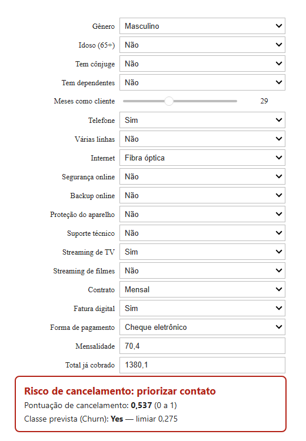

# NeuroStartup — Previsão de cancelamento de clientes

Atividade Prática 3 · Classificação binária com o dataset Telco Customer Churn

## Integrantes

| Nome completo | R.A. |
| --- | --- |
| Igor Ventura | 1722540 |
| Erick Ventura | 3099001 |
| Pedro Camargo | 1860175 |
| Fernando Landim | 1794239 |

## Objetivo

O projeto prevê o cancelamento de clientes de uma operadora de telecomunicações. A demonstração recebe informações como tipo de contrato, tempo de relacionamento e cobrança mensal. A previsão pode ajudar uma equipe de retenção a priorizar quais clientes contatar.

## Dados e metodologia

Cada linha do dataset representa um cliente. A variável alvo é `Churn`, em que `Yes` indica cancelamento e `No` indica permanência. A análise exploratória mostra a taxa de cancelamento por tipo de contrato e compara a distribuição do tempo de relacionamento entre clientes que cancelaram e clientes que permaneceram.

Os dados foram divididos de forma estratificada em 60% para treino, 20% para validação e 20% para teste, com seed `42`. O pré-processamento foi ajustado somente no treino. Foram comparadas uma regressão logística e três configurações de redes neurais em Keras, com *early stopping*. A validação orientou a escolha da rede para a demonstração e dos limiares de classificação. O teste foi reservado para a comparação final.

[Fonte dos dados — Telco Customer Churn](https://www.kaggle.com/datasets/blastchar/telco-customer-churn)

## Uso de inteligência artificial

O grupo usou o ChatGPT como apoio ao planejamento do projeto, à organização das issues, à preparação do código de avaliação e à redação da documentação. A equipe conduziu a execução, conferiu as saídas dos notebooks e interpretou os resultados apresentados.

## Como executar

### 1. Clonar o repositório e instalar as dependências

Com Git e Python instalados, execute no PowerShell:

```powershell
git clone https://github.com/IgorVentura0517/neurostartup-telco-churn.git
cd neurostartup-telco-churn
py -m venv .venv
.\.venv\Scripts\python.exe -m pip install -r requirements.txt
```

### 2. Abrir a demonstração

Abra a pasta do projeto no VS Code com a extensão Jupyter instalada. Abra [`demo_previsao.ipynb`](demo_previsao.ipynb), selecione o kernel Python da `.venv` e execute as células do notebook em ordem. A demonstração usa a rede e o pré-processador já salvos em `artefatos/`.



### 3. Obter os dados para executar os notebooks de análise e treinamento

Na raiz do projeto, execute:

```powershell
.\.venv\Scripts\python.exe .\download_csv.py
```

O arquivo `WA_Fn-UseC_-Telco-Customer-Churn.csv` deve aparecer na raiz. Use o kernel Python da `.venv` para abrir os notebooks. Os resultados da avaliação final podem ser consultados diretamente nas saídas salvas em `avaliacao_final.ipynb`.

## Resultados no conjunto de teste

As métricas abaixo consideram `Churn=Yes` como classe positiva. Os limiares foram definidos na validação.

| Modelo | Limiar | Precisão | Recall | F1 | Cancelamentos identificados | Falsos positivos |
| --- | ---: | ---: | ---: | ---: | ---: | ---: |
| Regressão logística | 0,375 | 55,97% | 68,98% | 61,80% | 258 de 374 | 203 |
| Keras_1 | 0,275 | 52,13% | 75,13% | 61,56% | 281 de 374 | 258 |

A regressão logística obteve maior precisão e um F1 ligeiramente superior. A rede `Keras_1`, usada na demonstração, identificou 23 cancelamentos a mais e sinalizou 55 clientes a mais que permaneceram. Se cada sinalização gerasse um contato de retenção, a rede exigiria 78 contatos adicionais para identificar esses 23 cancelamentos a mais.

## Arquivos do projeto

| Arquivo | Conteúdo |
| --- | --- |
| [`analise_churn.ipynb`](analise_churn.ipynb) | Análise exploratória e conclusões dos gráficos |
| [`pre_processamento.ipynb`](pre_processamento.ipynb) | Divisão dos dados e pré-processamento |
| [`treinamento_modelos.ipynb`](treinamento_modelos.ipynb) | Treinamento da regressão logística e das redes Keras |
| [`experimentos.csv`](experimentos.csv) | Registro dos experimentos de modelagem |
| [`avaliacao_final.ipynb`](avaliacao_final.ipynb) | Métricas, matrizes de confusão e conclusão de negócio |
| [`demo_previsao.ipynb`](demo_previsao.ipynb) | Demonstração interativa da previsão |
| [`MODEL_CARD.md`](MODEL_CARD.md) | Uso previsto, desempenho e limitações da rede |